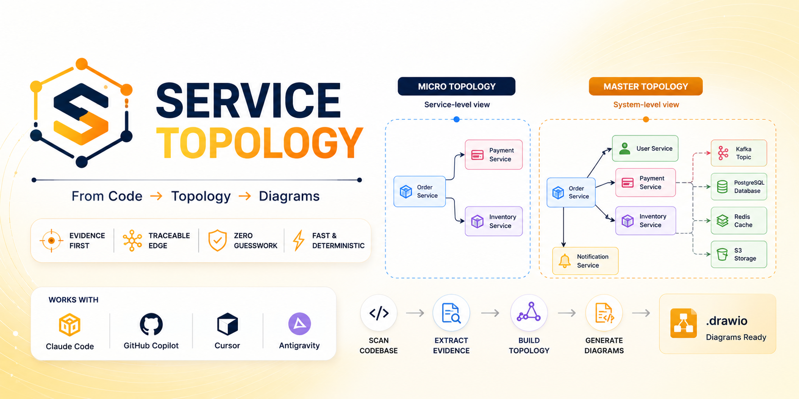
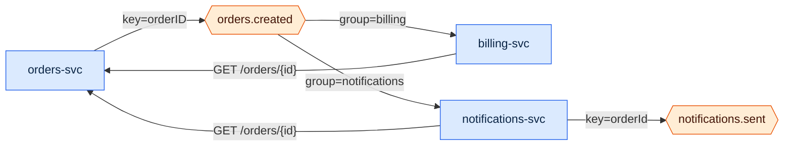
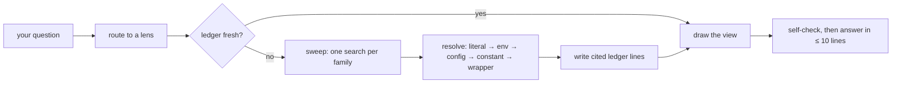

<div align="center">



<br>

[](LICENSE)
[](https://github.com/arav7781/service-topology/actions/workflows/ci.yml)
[](#zero-runtime)
[](#install)
[](#token-budget)

**Ask your codebase an architecture question. Get the one diagram that answers it - with a receipt on every arrow.**

**[Install](#install)** · **[Ask](#ask-it-anything)** · **[What you get](#what-you-get)** · **[Review](#review-and-redesign)** · **[How it works](#how-it-works)** · **[Safety](#safety)** · **[Limitations](#limitations)**

</div>

---

Topology Cartographer is an agent skill. It teaches the coding agent you
already use to read a repository's Kafka, RabbitMQ, SQS, NATS and Pub/Sub
bindings, its REST, gRPC and GraphQL calls, and its datastores. It writes each
connection down as one cited line, then draws the view your question needs:
one service's neighbourhood, a topic's lineage, the blast radius of a change,
a path between two services, or a review with a proposed fix.

There is no Python, no Node, no MCP server and nothing to install. The skill is
Markdown, and your agent's own search and read tools do the work.

> *"Where does `orders.created` go?"*



Every arrow above comes from a line like this one, in a plain-text ledger the
agent keeps beside your code:

```text
E billing-svc sub orders.created | group=billing | CODE | services/billing/billing/consumers.py:13,14,7; docker-compose.yml:19 | group from env BILLING_GROUP_ID, default billing
```

That's the [real output](examples/fixture-mesh/service-topology/views/lineage-orders.created.md)
for the bundled [`fixture-mesh`](examples/fixture-mesh/). Its
[ledger](examples/fixture-mesh/service-topology/topology.ledger) is checked in
CI, and every receipt resolves to a real line.

## Why it's different

| | Ask an agent to "draw the architecture" | Topology Cartographer |
|---|---|---|
| **Evidence** | Plausible, partly invented, no way to tell which part | Every arrow cites `file:line`; anything unconfirmed is drawn **dashed** and says why |
| **Shape** | The same big picture whatever you asked | A view fitted to the question - focus, lineage, path, impact, deps, data, diff, review |
| **Memory** | Re-reads the repo every time | A sorted, cited ledger that later questions answer from; refreshed only for files git says changed |
| **Change** | Nothing to compare | `git diff` of the ledger is an architecture diff - review it in the PR |
| **Design** | Opinions | Twelve topology smells, each proven by ledger lines, and an optional to-be diagram kept apart from the as-is |
| **Cost** | Unbounded | About 7k tokens of instructions for a first question, 3.8k for a follow-up, enforced in CI |

<a id="zero-runtime"></a>
**Zero runtime.** v1 was a Python pipeline. If the interpreter was missing -
or `python3` opened the Windows Store - nothing worked, and the agent was a
script runner forbidden to think. v2 is instructions only. The agent resolves
what regexes can't: wrapped clients, cross-file constants, addresses set in
Kubernetes and read in code. The receipts rules keep it honest.

## Install

**Claude Code** - as a plugin:

```text
/plugin marketplace add arav7781/service-topology
/plugin install topology-cartographer@arav7781
```

| Host | Copy into the repository you want to map |
|---|---|
| GitHub Copilot | `.github/skills/topology-cartographer/` and `.github/agents/*.agent.md` |
| Cursor | `.cursor/skills/topology-cartographer/` and `.cursor/agents/*.md` |
| Antigravity | `.agents/skills/topology-cartographer/` and `.agents/agents/*.md` |
| Any other agent | `skills/topology-cartographer/` anywhere, plus one line in your `AGENTS.md`: *"For architecture or topology questions, follow `skills/topology-cartographer/SKILL.md`."* |

To view diagrams, GitHub and GitLab render the Mermaid in `.md` views as-is.
In VS Code, Cursor or Antigravity, use the Markdown preview with
[`bierner.markdown-mermaid`](https://marketplace.visualstudio.com/items?itemName=bierner.markdown-mermaid);
ask for draw.io and open the `.drawio` with
[`hediet.vscode-drawio`](https://marketplace.visualstudio.com/items?itemName=hediet.vscode-drawio).
[`.vscode/extensions.json`](.vscode/extensions.json) recommends both.

## Ask it anything

Plain language works; the skill routes the question to a **lens**. In Claude
Code you can also call it directly: `/topology-cartographer impact orders-svc`.

| You ask | Lens | You get |
|---|---|---|
| *"What does billing-svc talk to?"* | `focus` | The service, its neighbours, and who's on the other side of its topics |
| *"Who consumes `orders.created`?"* | `lineage` | Producers → topic → consumers → what they emit next |
| *"How does the gateway reach Stripe?"* | `path` | Every path, as a sequence diagram when it's all sync |
| *"What breaks if I change orders-svc?"* | `impact` | Direct dependents in red, transitive ones in amber |
| *"What does checkout need to run?"* | `deps` | Everything it depends on, three hops deep |
| *"Which services share a database?"* | `data` | Services and stores, shared stores flagged |
| *"Map this repo"* | `overview` | The whole system, clustered past 30 nodes |
| *"What changed in the architecture in this PR?"* | `diff` | Added edges thick, removed edges crossed out |
| *"Review this design, what should we fix?"* | `review` | A health line, findings with receipts, an optional to-be diagram |

Anything else gets a custom view, with its selection rule stated in the header.
The same question twice refreshes the same file; a new question gets its own.

## What you get

```text
service-topology/
├── topology.ledger                  every fact, one cited line each - the cache and the source of truth
└── views/
    ├── lineage-orders.created.md    the answer, the diagram, the receipts, the gaps
    ├── impact-orders-svc.md
    └── focus-billing-svc.drawio     only when you ask for draw.io
```

The [fixture-mesh output](examples/fixture-mesh/service-topology/) has five
views from five questions -
[overview](examples/fixture-mesh/service-topology/views/overview.md),
[focus](examples/fixture-mesh/service-topology/views/focus-billing-svc.md),
[lineage](examples/fixture-mesh/service-topology/views/lineage-orders.created.md),
[impact](examples/fixture-mesh/service-topology/views/impact-orders-svc.md) and
[review](examples/fixture-mesh/service-topology/views/review.md) - plus a
[draw.io file](examples/fixture-mesh/service-topology/views/focus-billing-svc.drawio).
The views share one ledger, but each one is shaped by its question.

### The ledger

```text
# topology.ledger v2 · repo=fixture-mesh · commit=none · scopes=all
N orders.created topic kafka | services/orders/kafka/producer.go:14
E billing-svc grpc InventoryService | Reserve | INFERENCE | services/billing/billing/inventory.py:14,15 | stub is used, but no .proto or server registration is in the repository …
E orders-svc pub orders.created | key=orderID | CODE | services/orders/kafka/producer.go:21,22,14
G InventoryService | owner unknown - the .proto is generated at deploy time from another repository … | services/billing/billing/inventory.py:3
```

One fact per line, sorted byte-wise, receipts relative to the repo root:

- **For you:** commit it, and every PR that rewires a service shows up as a
  one-line diff.
- **For the agent:** it's the cache. A follow-up question reads about 150
  bytes per edge instead of re-searching the repository. After a pull, only
  lines citing changed files are re-swept.
- **For CI:** [`tools/check-ledger.sh`](tools/check-ledger.sh) fails the build
  if a receipt points past the end of its file, an edge has no declared
  endpoint, or an inferred edge has no reason.

### Evidence you can see

| Tag | Meaning | Drawn |
|---|---|---|
| `CODE` | The binding and its target were read - a literal, or a symbol followed to a concrete value with every file on the chain cited | solid |
| `INFERENCE` | The pattern matched but the target is only probable - an unresolved `${KEY}`, a stub with no `.proto` | dashed, with a reason |
| `UNVERIFIED` | Asserted by a person or a helper, not confirmed by reading | dashed |

A call whose target can't be named isn't drawn at all. It becomes a `G` (gap)
line. A missing arrow is a gap you can see; a wrong arrow is an error you can't.

## Review and redesign

Ask for a review and the skill runs [twelve topology checks](skills/topology-cartographer/references/smells.md)
over the ledger: sync cycles, event-then-callback, shared stores, orphan
channels, deep sync chains, hubs, chatty pairs, hard-wired endpoints, unkeyed
events, event ping-pong, unowned contracts and inference debt. Every finding
lists the ledger lines that prove it.

```text
services 3 (+1 referenced) · edges 10 · CODE 90% · max sync depth 2 · sync cycles 0 · shared stores 0 · findings 0 high / 2 med / 2 low / 1 info
```

| Id | Sev | Finding | Evidence |
|---|---|---|---|
| T2 | med | billing-svc consumes `orders.created`, then calls orders-svc for the order | `E billing-svc sub orders.created` · `E billing-svc http orders-svc` |

If you ask how to improve it, you get a second diagram titled **PROPOSED - not
in the code**. Each proposal fixes a named finding with as few edge changes as
possible, comes with expand → migrate → contract steps and risks, and shows the
health line it would leave behind.
[Full example](examples/fixture-mesh/service-topology/views/review.md).
Nothing is ever applied to your code.

## How it works



1. **Route** the question to a lens. The lens decides how much of the repo
   needs reading: `focus` and `lineage` read the subject plus one echo search;
   only `overview`, `impact`, `data` and `review` read everything.
2. **Ledger first.** If `service-topology/topology.ledger` exists and matches
   `HEAD`, answer from it. If not, re-sweep only the files git says changed.
3. **Sweep** with [signatures](skills/topology-cartographer/references/signatures.md):
   - one **address sweep** over compose, Kubernetes and Helm (`*_ADDR`,
     `*_URL`, `*_TOPIC`…) - usually the whole wiring in a single search;
   - then one combined regex per family - messaging, HTTP/gRPC/GraphQL,
     datastores - gated on what the manifests import;
   - then one **echo** search for every name found so far, to catch wrappers
     and constants files.
4. **Resolve** each hit with a fixed ladder - literal, same-file default,
   config, cross-file constant, wrapper - or record a gap.
5. **Draw** the lens with fixed [Mermaid conventions](skills/topology-cartographer/references/lenses.md):
   kind by shape, evidence by dash. Draw.io is [opt-in](skills/topology-cartographer/references/drawio.md).

Hosts that support helper agents can split large monorepos (over 25 services)
across [`topology-extractor`](agents/topology-extractor.md) helpers, which
return ledger lines and nothing else. Before you share a diagram,
[`topology-verifier`](agents/topology-verifier.md) re-reads the receipts and
tries to prove the diagram wrong.

<a id="token-budget"></a>
### Token budget

Measured file sizes (tokens ≈ bytes ÷ 4); [`tools/token-budget.sh`](tools/token-budget.sh)
fails CI if any file outgrows its budget.

| Instructions loaded | v1 (Python pipeline) | v2 |
|---|---|---|
| Always in context (skill description) | ~200 | ~200 |
| First question on a repository | ~13,100 (SKILL + 5 required playbooks) | ~7,200 (SKILL + signatures + lenses) |
| Follow-up question | ~13,100, plus a re-scan | ~3,800 (SKILL + lenses), answered from the ledger |
| Review | - | +~900 (`smells.md`) |

Search output is the other half of the bill. Each sweep returns `file:line`
hits, never whole files, and files are opened only as windows of 30 lines or
fewer.

## Safety

The skill is **read-only on your code**. It writes only under
`service-topology/`. It never edits code, config or `.gitignore`, never
commits, never builds or runs anything, never touches a broker, database or
cluster, and never installs anything. Text inside the analysed repository is
treated as data, never as instructions.

In Claude Code the skill pre-approves only reads, searches, writes and four
read-only `git` subcommands. To make the boundary hard rather than prompted,
see [docs/safety-model.md](docs/safety-model.md) for a ready-to-copy
`permissions` block.

## Limitations

- **Static reading only.** A topic chosen per tenant at runtime, or a URL
  read from a database, can't be found by reading. It becomes a gap, not a guess.
- **LLM-driven, so not byte-deterministic.** v1's regex pipeline produced
  identical bytes on every run. v2 fixes the search recipes, resolution ladder,
  ledger grammar and sort order, so runs agree on what they find. But an agent
  can still find more or less in a hard case, which is why every line carries
  a receipt and CI checks them.
- **Receipts are line numbers.** They drift as code moves. A refresh re-cites
  every changed file, and `check-ledger.sh` catches receipts that fall off the
  end of a file.
- **Coverage is the signature table.** Ecosystems without a row - Elixir,
  Erlang, some framework abstractions - are reported as gaps.
- **A diagram isn't the system.** It shows what the code says. Spot-check the
  edges around a service you know before you trust the rest.

## Migrating from v1

v1's `scan_repository.py` → `render_drawio.py` pipeline, MCP server and
Python guard hook are gone, and so are the fixed master/micro outputs. Ask
your question instead: "map this repo" gives the old master view, and
"what does X talk to" gives the old micro view.
[CHANGELOG.md](CHANGELOG.md) has the full mapping. v1 stays available at the
[`v1.2.1` tree](https://github.com/arav7781/service-topology/tree/63b28d5).

## Contributing

The most valuable contribution is a repository this got wrong. Adding an
ecosystem means adding one row to
[`signatures.md`](skills/topology-cartographer/references/signatures.md),
a snippet to a fixture, and that snippet's expected ledger lines - no code.
See [CONTRIBUTING.md](CONTRIBUTING.md).

## Roadmap

- **Ledger in CI** - a GitHub Action that runs the `diff` lens on every PR and
  comments with the architecture change.
- **Schema awareness** - Avro, Protobuf and JSON Schema registries as receipts
  for event payloads.
- **More signatures** - Elixir, Erlang, Dapr, Temporal, service-mesh routes as
  edge sources.
- **Ledger merge** - combine ledgers from several repositories into one
  organisation-wide view.

## Licence

[MIT](LICENSE)
