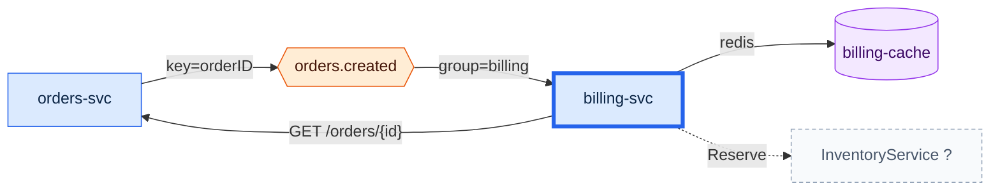

# What does billing-svc talk to?
`focus billing-svc` · ledger none · 5 nodes · 5 edges (4 CODE, 1 inferred)

`billing-svc` consumes `orders.created` (group `billing`) and, for each order,
calls `orders-svc` `GET /orders/{id}` for the fields the event leaves out. It
keeps a Redis cache, `billing-cache`. It also appears to call an
`InventoryService` over gRPC (`Reserve`) - unconfirmed, because neither the
`.proto` nor a server registration is in this repository.

| Edge | Tag | Receipts |
|---|---|---|
| orders-svc → orders.created · key=orderID | CODE | `services/orders/kafka/producer.go:21,22,14` |
| orders.created → billing-svc · group=billing | CODE | `services/billing/billing/consumers.py:13,14,7` · `docker-compose.yml:19` |
| billing-svc → orders-svc · GET /orders/{id} | CODE | `services/billing/billing/orders_client.py:12,7` · `docker-compose.yml:18` · `services/orders/api/openapi.yaml:8` |
| billing-svc → billing-cache · redis | CODE | `services/billing/billing/cache.py:5` · `docker-compose.yml:20,22` |
| billing-svc ⇢ InventoryService · Reserve | INFERENCE | `services/billing/billing/inventory.py:14,15` - stub only |

**Not shown:** the other consumer of `orders.created` (`notifications-svc`),
which is a sibling, not a neighbour. The owner of `InventoryService` is
unknown - its `.proto` is generated at deploy time from another repository
(`services/billing/billing/inventory.py:3`).
