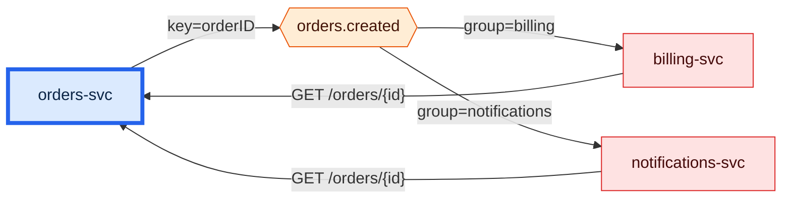

# What breaks if I change orders-svc's API or its events?
`impact orders-svc` · ledger none · 4 nodes · 5 edges (5 CODE)

Two services break on a contract change, and they break twice over:
`billing-svc` and `notifications-svc` each consume `orders.created` **and**
call `GET /orders/{id}`. A change to the event schema or to that endpoint hits
both. Nothing depends on either of them in turn, so the blast radius stops at
ring 1. `orders-db` and `api.stripe.com` are things orders-svc depends on, not
dependents, so they are outside the blast radius.

| Ring | Service | Breaks because | Receipts |
|---|---|---|---|
| 1 | billing-svc | consumes `orders.created` · calls `GET /orders/{id}` | `services/billing/billing/consumers.py:13` · `services/billing/billing/orders_client.py:12` |
| 1 | notifications-svc | consumes `orders.created` · calls `GET /orders/{id}` | `services/notifications/src/consumer.ts:13` · `services/notifications/src/orders.ts:5` |

**Not shown:** consumers outside this repository. `orders.created` may have
readers elsewhere that no static scan can see.
