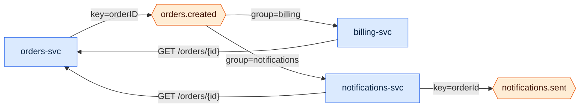

# Where does orders.created go?
`lineage orders.created` · ledger none · 5 nodes · 6 edges (6 CODE)

`orders-svc` publishes `orders.created`, keyed by order id. Two groups read it:
`billing` and `notifications`. Each consumer then calls back to `orders-svc`
for the full order, so the event alone is not enough to act on.
`notifications-svc` emits `notifications.sent`, and the trail ends there - no
consumer of it exists in this repository.

| Edge | Tag | Receipts |
|---|---|---|
| orders-svc → orders.created · key=orderID | CODE | `services/orders/kafka/producer.go:21,22,14` |
| orders.created → billing-svc · group=billing | CODE | `services/billing/billing/consumers.py:13,14,7` · `docker-compose.yml:19` |
| orders.created → notifications-svc · group=notifications | CODE | `services/notifications/src/consumer.ts:13,8` |
| notifications-svc → notifications.sent · key=orderId | CODE | `services/notifications/src/consumer.ts:25,26` |
| billing-svc → orders-svc · GET /orders/{id} | CODE | `services/billing/billing/orders_client.py:12,7` · `docker-compose.yml:18` |
| notifications-svc → orders-svc · GET /orders/{id} | CODE | `services/notifications/src/orders.ts:5,1` |

**Not shown:** the consumers' own stores and calls (`billing-cache`,
`InventoryService`), which are not part of the event's path.
