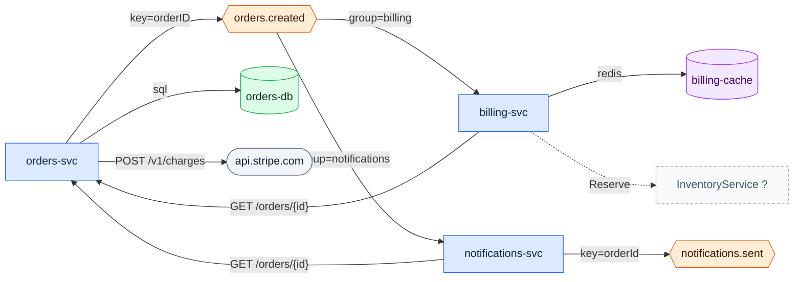

# Draw the architecture of this repository
`overview` · ledger none · 9 nodes · 10 edges (9 CODE, 1 inferred)

Three services share one Kafka topic. `orders-svc` writes orders to PostgreSQL,
charges cards through Stripe and publishes `orders.created`. `billing-svc` and
`notifications-svc` both consume it, and both call back into `orders-svc` for
fields the event does not carry. `billing-svc` appears to call an
`InventoryService` over gRPC (unconfirmed: no `.proto` in the repository).

| Edge | Tag | Receipts |
|---|---|---|
| orders-svc → orders.created · key=orderID | CODE | `services/orders/kafka/producer.go:21,22,14` |
| orders.created → billing-svc · group=billing | CODE | `services/billing/billing/consumers.py:13,14,7` · `docker-compose.yml:19` |
| orders.created → notifications-svc · group=notifications | CODE | `services/notifications/src/consumer.ts:13,8` |
| notifications-svc → notifications.sent · key=orderId | CODE | `services/notifications/src/consumer.ts:25,26` |
| billing-svc → orders-svc · GET /orders/{id} | CODE | `services/billing/billing/orders_client.py:12,7` · `docker-compose.yml:18` · `services/orders/api/openapi.yaml:8` |
| notifications-svc → orders-svc · GET /orders/{id} | CODE | `services/notifications/src/orders.ts:5,1` · `services/orders/api/openapi.yaml:8` |
| orders-svc → api.stripe.com · POST /v1/charges | CODE | `services/orders/payments.go:10` |
| orders-svc → orders-db · sql | CODE | `services/orders/main.go:18,11` · `docker-compose.yml:10,12` |
| billing-svc → billing-cache · redis | CODE | `services/billing/billing/cache.py:5` · `docker-compose.yml:20,22` |
| billing-svc ⇢ InventoryService · Reserve | INFERENCE | `services/billing/billing/inventory.py:14,15` - stub only; no `.proto` or server registration in the repository |

**Not shown:** compose `depends_on` lines, folded into the store edges as
receipts; `ORDERS_TOPIC` at `docker-compose.yml:9`, which is declared but never
read - the code names the topic literally.
