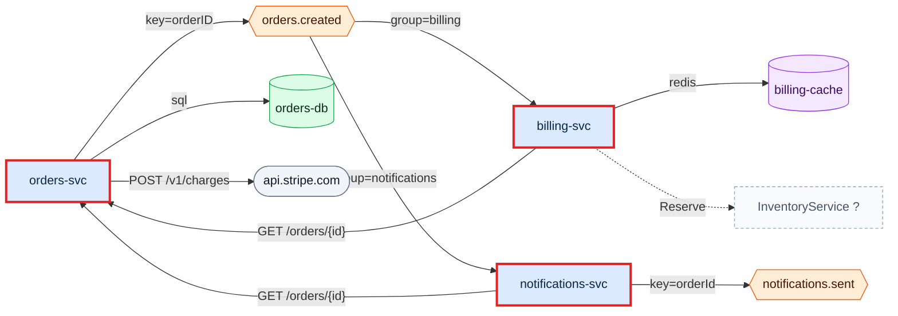
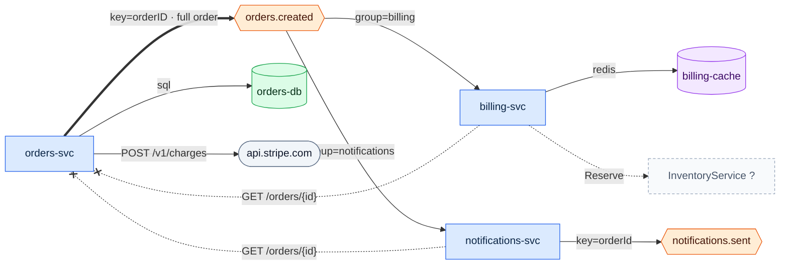

# Review this topology and suggest improvements
`review` · ledger none · 9 nodes · 10 edges (9 CODE, 1 inferred)

```text
services 3 (+1 referenced) · edges 10 · CODE 90% · max sync depth 2 · sync cycles 0 · shared stores 0 · findings 0 high / 2 med / 2 low / 1 info
```

The system is small and acyclic, and nothing shares a store. The one
structural problem is that `orders.created` does not carry what its consumers
need: both consumers call `orders-svc` back for every event. That puts
`orders-svc` on their critical path, and the event-driven split buys less
decoupling than it looks like.

| Id | Sev | Finding | Evidence |
|---|---|---|---|
| T2 | med | billing-svc consumes `orders.created`, then calls orders-svc for the order | `E billing-svc sub orders.created` · `E billing-svc http orders-svc` |
| T2 | med | notifications-svc consumes `orders.created`, then calls orders-svc for the order | `E notifications-svc sub orders.created` · `E notifications-svc http orders-svc` |
| T4 | low | `notifications.sent` is produced and never consumed in this repository | `E notifications-svc pub notifications.sent` |
| T8 | low | the Stripe URL is a literal at the call site | `E orders-svc http api.stripe.com` (`services/orders/payments.go:10`) |
| T11 | info | `InventoryService`'s contract is not in the repository | `E billing-svc grpc InventoryService` (INFERENCE) |

## As-is



## PROPOSED - not in the code



### P1 - carry the order in the event (fixes both T2)

Publish what the consumers fetch today in `orders.created`: the full order the
invoice needs (`services/billing/billing/orders_client.py:11`) and the
customer email (`services/notifications/src/orders.ts:3`). Then drop the two
callbacks.

1. **Expand** - orders-svc adds the fields to the payload, additively, with a
   schema version.
2. **Migrate** - each consumer reads the event first and keeps the `GET` as a
   fallback behind a flag.
3. **Contract** - remove the fallback once no consumer has used it for a release.

Risks: a customer email on the topic is personal data, so review topic ACLs
and retention before shipping. Payloads grow. Schema evolution needs a
registry or a compatibility rule.

After: `max sync depth 1 · findings 0 high / 0 med / 2 low / 1 info`, and
orders-svc no longer has to be up for billing or notifications to make progress.

### P2 - find the reader of `notifications.sent` (T4)

No diagram change until someone confirms whether a consumer exists outside
this repository. If none does, the producer is dead code.

### P3 - configure the Stripe base URL (T8)

Read it from config behind a small payments client, so it can be pointed at a
sandbox per environment.

### P4 - vendor the inventory contract (T11)

Bring `inventory.proto` in, or reference it from a contracts registry, so the
dashed edge to `InventoryService` can become `CODE`.
