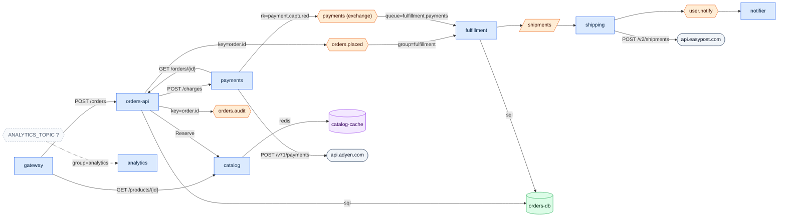

# Draw the architecture of this repository
`overview` · ledger none · 18 nodes · 20 edges (19 CODE, 1 inferred)

Eight services over four transports. `gateway` fronts `orders-api` and
`catalog` over HTTP. `orders-api` charges through `payments` (Feign), reserves
stock in `catalog` (gRPC) and publishes `orders.placed` and `orders.audit` to
Kafka. `payments` calls Adyen and announces captures on a RabbitMQ exchange.
`fulfillment` reacts to both events and hands shipments to `shipping` through
SQS, and `shipping` tells `notifier` over NATS. `analytics` appears to consume
a Kafka topic whose name is only set at deploy time (unconfirmed).

| Edge | Tag | Receipts |
|---|---|---|
| gateway → orders-api · POST /orders | CODE | `services/gateway/src/routes.ts:11,5` · `docker-compose.yml:5` |
| gateway → catalog · GET /products/{id} | CODE | `services/gateway/src/routes.ts:16,6` · `docker-compose.yml:6` |
| orders-api → payments · POST /charges | CODE | `…/orders/PaymentsClient.java:6,8` · `docker-compose.yml:10` |
| payments → orders-api · GET /orders/{id} | CODE | `services/payments/main.go:18,9` · `docker-compose.yml:13` |
| orders-api → catalog · Reserve | CODE | `…/orders/InventoryClient.java:13,17,11` · `…/resources/application.yml:7` · `services/catalog/catalog/grpc_server.py:15` |
| orders-api → orders.placed · key=order.id | CODE | `…/orders/OrderEvents.java:15,8` · `…/orders/Topics.java:4` |
| orders-api → orders.audit · key=order.id | CODE | `…/orders/OrderEvents.java:16,8` · `…/orders/Topics.java:5` |
| orders-api → orders-db · sql | CODE | `…/resources/application.yml:5` · `docker-compose.yml:9` |
| payments → payments (exchange) · rk=payment.captured | CODE | `services/payments/events.go:15` |
| payments → api.adyen.com · POST /v71/payments | CODE | `services/payments/events.go:14` |
| orders.placed → fulfillment · group=fulfillment | CODE | `…/fulfillment/main.py:9,6,8` · `…/fulfillment/bus.py:11,8` · `services/fulfillment/.env:2` |
| payments (exchange) → fulfillment · queue=fulfillment.payments | CODE | `…/fulfillment/rabbit.py:13,6` |
| fulfillment → orders-db · sql | CODE | `…/fulfillment/db.py:4` · `docker-compose.yml:18` |
| fulfillment → shipments | CODE | `…/fulfillment/shipments.py:9` · `services/fulfillment/.env:1` |
| shipments → shipping | CODE | `services/shipping/src/poller.ts:7` · `docker-compose.yml:22` |
| shipping → api.easypost.com · POST /v2/shipments | CODE | `services/shipping/src/carrier.ts:4` |
| shipping → user.notify | CODE | `services/shipping/src/notify.ts:7` |
| user.notify → notifier | CODE | `services/notifier/main.go:11` |
| ANALYTICS_TOPIC ? ⇢ analytics · group=analytics | INFERENCE | `services/analytics/analytics/consume.py:5` · `docker-compose.yml:31` - no value in the repository |
| catalog → catalog-cache · redis | CODE | `services/catalog/catalog/app.py:7` · `docker-compose.yml:35` |

**Not shown:** `notifier`'s per-tenant alerts - the subject is built at runtime
(`services/notifier/main.go:19`). Not drawn, by rule: the Express
`res.send`, the RxJS `.subscribe`, the `localhost` health check, the test
consumer in `services/fulfillment/tests/`, and the generated
`inventory_pb2_grpc.py`.
