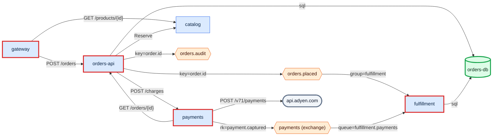
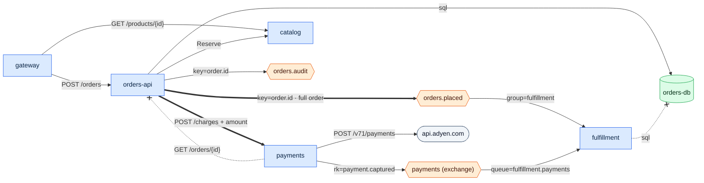

# Review this architecture - what should we fix first?
`review` · ledger none · 18 nodes · 20 edges (19 CODE, 1 inferred)

```text
services 8 · edges 20 · CODE 95% · max sync depth 3 · sync cycles 1 · shared stores 1 · findings 2 high / 2 med / 2 low / 1 info
```

Fix the two high findings first. Both are about `orders-api`. `payments`
calls back into its own caller, so the two cannot be deployed or fail
independently. And `fulfillment` reads `orders-api`'s database directly, so
the orders schema cannot change without breaking it. Both have small fixes
because the data the callers need is already flowing; it just isn't carried
far enough.

| Id | Sev | Finding | Evidence |
|---|---|---|---|
| T1 | high | sync cycle orders-api ⇄ payments | `E orders-api http payments` · `E payments http orders-api` |
| T3 | high | orders-db is used by orders-api and fulfillment | `E orders-api uses orders-db` · `E fulfillment uses orders-db` |
| T5 | med | gateway → orders-api → payments → api.adyen.com is 3 sync hops | `E gateway http orders-api` · `E orders-api http payments` · `E payments http api.adyen.com` |
| T6 | med | orders-api sits on 7 of 20 edges | every `E` line naming orders-api |
| T4 | low | `orders.audit` is produced and never consumed | `E orders-api pub orders.audit` |
| T8 | low | Adyen and EasyPost URLs are literals at the call site | `services/payments/events.go:14` · `services/shipping/src/carrier.ts:4` |
| T4 | info | `ANALYTICS_TOPIC ?` has a consumer but an unknown name, so its producer cannot be matched | `E analytics sub ANALYTICS_TOPIC?` (INFERENCE) |

## As-is



The shipping, notifier, analytics and catalog-cache parts of the graph have no
high or medium finding and are left out of this view; see `overview.md`.

## PROPOSED - not in the code



### P1 - send the amount with the charge (fixes T1)

`payments` calls back only to check the amount
(`services/payments/main.go:16`). Add the amount to `POST /charges`, then
drop the `GET /orders/{id}` callback. Expand: accept an optional amount.
Migrate: orders-api sends it. Contract: remove the lookup. Risk: payments
must now trust its caller's amount, so sign the request or validate the total
against the order event later.

### P2 - let fulfillment stop reading orders-db (fixes T3)

`fulfillment` already consumes `orders.placed`. Carry the order fields it
reads today in that event, and keep any lookups in a fulfillment-owned store.
Expand: add the fields to the event. Migrate: fulfillment reads the event.
Contract: revoke fulfillment's database credentials. Risk: the event grows,
and its schema now needs a compatibility rule.

After P1 and P2: `sync cycles 0 · shared stores 0 · findings 0 high / 2 med / 2 low / 1 info`.

### Next, not drawn

- **T5 / T6:** charge asynchronously. `payments` consumes `orders.placed`
  instead of being called. That takes payments and Adyen off the checkout
  request path and takes one more edge off orders-api. It's a bigger change,
  so do it after P1 shows the amount handoff works.
- **T4:** find out who reads `orders.audit`; if nobody does, stop producing it.
- **T8:** move the Adyen and EasyPost base URLs into config.
