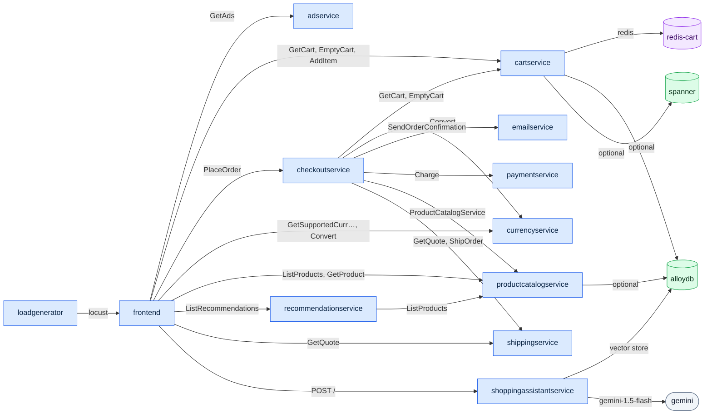

# Draw the architecture of Online Boutique
`overview` · ledger 38e7348 · 16 nodes · 22 edges (22 CODE)

A gRPC mesh behind one HTTP frontend. `frontend` calls seven services and
places orders through `checkoutservice`, which fans out to six more.
`recommendationservice` reads the product catalog, and `cartservice` keeps
carts in Redis. The opt-in shopping assistant adds an HTTP hop to a Python
service that talks to Gemini and AlloyDB. Three edges are optional backends
that config switches on (`optional:` labels), not the default deployment.

Receipts for every edge are in [`../topology.ledger`](../topology.ledger).
Each one resolves at
[`38e7348`](https://github.com/GoogleCloudPlatform/microservices-demo/tree/38e7348eb289eb5b87c0c6e8cb19ced0449dc389).
A few to spot-check:

| Edge | Primary receipt |
|---|---|
| frontend → checkoutservice · PlaceOrder | [`src/frontend/handlers.go:354`](https://github.com/GoogleCloudPlatform/microservices-demo/blob/38e7348eb289eb5b87c0c6e8cb19ced0449dc389/src/frontend/handlers.go#L354) |
| checkoutservice → paymentservice · Charge | [`src/checkoutservice/main.go:370`](https://github.com/GoogleCloudPlatform/microservices-demo/blob/38e7348eb289eb5b87c0c6e8cb19ced0449dc389/src/checkoutservice/main.go#L370) |
| cartservice → redis-cart | [`src/cartservice/src/Startup.cs:36`](https://github.com/GoogleCloudPlatform/microservices-demo/blob/38e7348eb289eb5b87c0c6e8cb19ced0449dc389/src/cartservice/src/Startup.cs#L36) · [`kubernetes-manifests/cartservice.yaml:51`](https://github.com/GoogleCloudPlatform/microservices-demo/blob/38e7348eb289eb5b87c0c6e8cb19ced0449dc389/kubernetes-manifests/cartservice.yaml#L51) |
| recommendationservice → productcatalogservice · ListProducts | [`src/recommendationservice/recommendation_server.py:73`](https://github.com/GoogleCloudPlatform/microservices-demo/blob/38e7348eb289eb5b87c0c6e8cb19ced0449dc389/src/recommendationservice/recommendation_server.py#L73) |

**Not shown:** the packaging-info call (`PACKAGING_SERVICE_URL` has no value in
any manifest), OpenTelemetry export (optional, no default collector), and
whether the three AlloyDB users share one cluster - that is decided at deploy
time.
